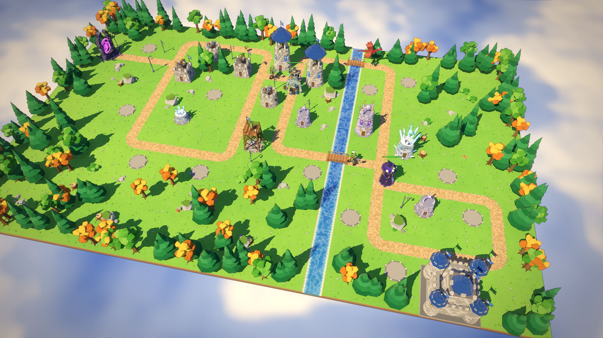
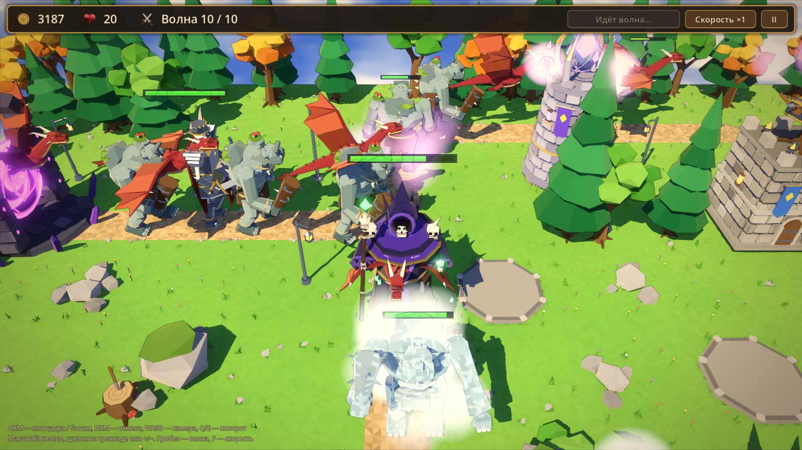
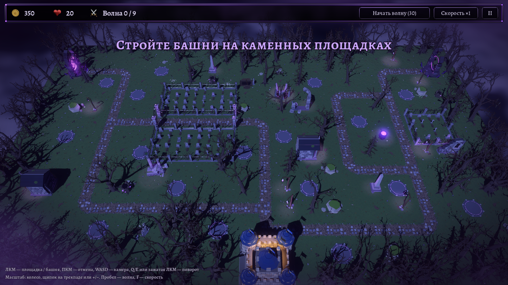

# Стражи Крепости

3D Tower Defence в стиле low-poly фэнтези. Курсовой проект, сделан на Godot 4.7.

Орды гоблинов, орков, троллей, виверн и нежити идут из тёмных порталов к вашему замку.
Стройте и улучшайте башни на каменных площадках вдоль дороги и не дайте врагам дойти до ворот.
Два уровня: солнечная «Долина развилок» и ночной «Жуткий лес».



## Скачать

Готовые сборки лежат в разделе [Releases](https://github.com/Aveyi/kurs-tower-defence/releases/latest):

| Система | Файл |
|---|---|
| Windows 10/11 (64-бит) | `StrazhiKreposti-windows.zip` |
| macOS 11+ (Intel и Apple Silicon) | `StrazhiKreposti-macos.zip` |
| Linux (x86_64) | `StrazhiKreposti-linux.zip` |

Нужна видеокарта с поддержкой Vulkan, DirectX 12 или Metal: подойдёт почти любой компьютер
последних 6–7 лет. Если игра тормозит, выберите в «Настройках» профиль «Низкое».

## Как запустить

У игры нет платной цифровой подписи, поэтому при первом запуске система предупредит
о неизвестном разработчике. Это ожидаемо.

### Windows
1. Распакуйте архив и запустите `StrazhiKreposti.exe`.
2. Если появится окно «Windows защитила ваш компьютер», нажмите **«Подробнее»**, затем
   **«Выполнить в любом случае»**.

### macOS
1. Распакуйте архив и перенесите «Стражи Крепости.app» в «Программы» или в любую папку.
2. Откройте приложение. macOS сообщит, что не может проверить разработчика, нажмите «Готово».
3. Откройте **Системные настройки → Конфиденциальность и безопасность**, прокрутите вниз и
   нажмите **«Всё равно открыть»** напротив «Стражи Крепости».

Вместо шагов 2–3 можно выполнить в Терминале одну команду (путь к приложению подставьте свой):
```bash
xattr -dr com.apple.quarantine "/Applications/Стражи Крепости.app"
```

### Linux
```bash
unzip StrazhiKreposti-linux.zip
chmod +x StrazhiKreposti.x86_64
./StrazhiKreposti.x86_64
```

## Как играть

1. В главном меню нажмите **«Играть»** и выберите уровень.
2. Щёлкните по пустой каменной площадке и выберите башню. Внизу показана цена, при наведении
   видно радиус атаки.
3. Нажмите **«Начать волну»** или подождите, пока истечёт таймер.
4. За убитых врагов и пройденные волны даётся золото. Тратьте его на новые башни и улучшения:
   у каждой башни 3 уровня.
5. Каждый дошедший до замка враг отнимает жизни. Когда жизни кончаются, крепость пала.

### Уровни

**1. Долина развилок.** Зелёная долина, рассечённая рекой. Дорога трижды разветвляется, и враги
идут восемью разными путями. Башни на развилках прикрывают сразу несколько дорог. 10 волн.



**2. Жуткий лес.** Ночь, мёртвый лес, древние руины и старое кладбище, через которое идёт дорога.
Мертвецы выходят из портала на западе, а после рыцаря-призрака пробуждается второй портал на
востоке, и враги идут с двух сторон. 12 волн, в финале — каменный голем.



### Башни

| Башня | Цели | Особенность |
|---|---|---|
| Лучники | наземные и летающие | дешёвая, быстрая стрельба |
| Пушка | только наземные | бомбы бьют по площади, против толп |
| Башня мага | наземные и летающие | мощные заряды, против крепких врагов |
| Ледяной шпиль | наземные и летающие | слабый урон, замедляет врагов |
| Баллиста | наземные и летающие | снайпер: большая дальность и урон, редкие выстрелы, бьёт самого живучего врага, ×1.5 по летающим |

### Враги

Гоблин (быстрый и слабый), орк, тролль (медленный, очень живучий), виверна (летает, пушка её
не достаёт), а также боссы: рыцарь-скелет и некромант, который призывает гоблинов.

В «Жутком лесу»: скелет (быстрый и хрупкий), зомби (медленный, живучий), ведьма (лечит раненых
врагов вокруг — её стоит убивать первой), горгулья (летает) и два босса: рыцарь-призрак, который
каждые несколько секунд становится бесплотным и снаряды пролетают сквозь него, и каменный голем,
который ударом о землю оглушает башни рядом.

### Управление

| Действие | Клавиши |
|---|---|
| Выбрать площадку или башню | щелчок левой кнопкой мыши |
| Снять выделение | правая кнопка мыши |
| Двигать камеру | WASD / стрелки, перетаскивание средней кнопкой |
| Поворот и наклон камеры | Q / E, зажатая левая кнопка мыши |
| Приближение | колесо мыши, щипок или прокрутка двумя пальцами на трекпаде, + / − |
| Начать волну | Пробел |
| Скорость ×2 | F |
| Пауза, настройки | Esc |

## Об игре

Модели, звуки и графика сделаны с нуля программно, без готовых моделей, звуков и текстур:

- **Модели**: 12 врагов, 5 башен × 3 уровня, снаряды, два набора тайлов карты, замок, портал и
  декор (деревья, руины, могилы, склеп, кладбищенская ограда и др.) генерируются Python-скриптами
  в Blender (`tools/blender`), с анимациями и запечённым затенением.
- **Звук и музыка**: синтезированы кодом на numpy (`tools/audio`).
- **Графика**: собственные шейдеры (`shaders/`): мультяшное освещение, ветер в листве, вода
  с пеной по глубине, растворение врагов, ледяная корка, оглушение башен, призрачная
  бесплотность, магическое появление башен, небо с морем облаков, луной и звёздами, вихрь
  портала, контурные линии, цветокоррекция и анимированные рамки интерфейса «Жуткого леса».

Единственный сторонний ассет — шрифты [Alegreya и Alegreya SC](https://github.com/huertatipografica/Alegreya)
(© The Alegreya Project Authors, лицензия SIL Open Font License 1.1, текст в `assets/fonts/OFL.txt`).

## Для разработчиков

Нужен [Godot 4.7](https://godotengine.org/). Откройте папку проекта в редакторе и нажмите F5.

- Пересобрать модели: `/Applications/Blender.app/Contents/MacOS/Blender -b --factory-startup -P tools/blender/build.py`
- Пересобрать звуки: `/Applications/Blender.app/Contents/MacOS/Blender -b --factory-startup -P tools/audio/build_audio.py`
- Полный прогон 10 волн: `godot --path . -s tests/smoke_test.gd -- <папка_для_скриншотов> 10`
- Проверка баланса ботом: `godot --path . --headless -s tests/balance_bot.gd [-- res://data/levels/level_02.tres]`
- Пересобрать данные уровня 2 (раскладка, волны): `python3 tools/levels/level_02.py`
- Сборка: `godot --headless --path . --export-release "Windows" build/windows/StrazhiKreposti.exe`
  (пресеты `Windows`, `macOS`, `Linux` лежат в `export_presets.cfg`).
